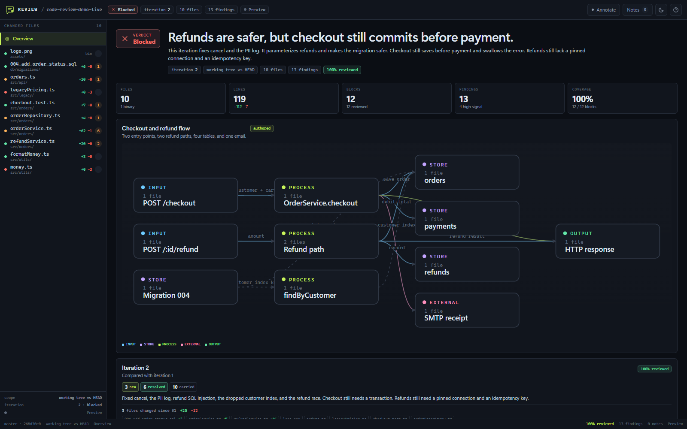
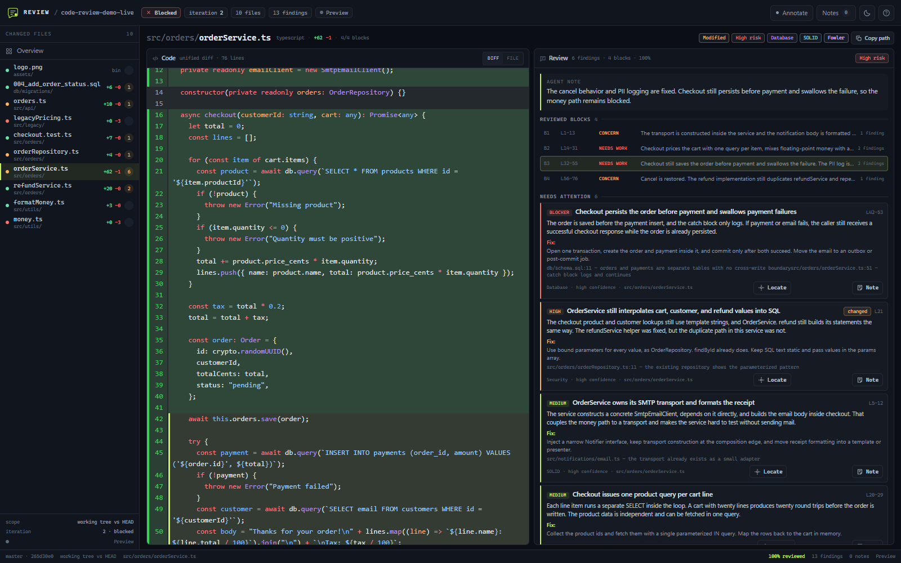
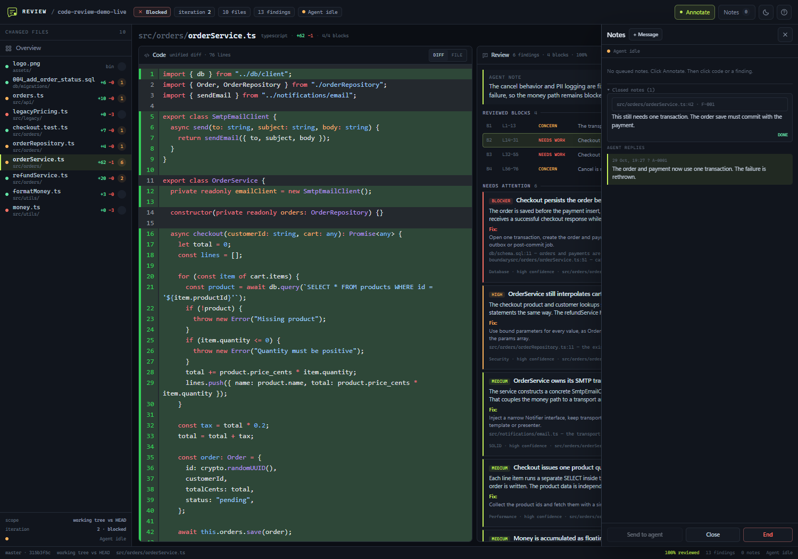

# code-review

A local code-review skill for coding agents. It turns a git change into an IDE-style review page:

- a list of every changed file,
- a full-context code pane,
- an agent review pane with findings, fixes, and reviewed blocks,
- a change-flow graph,
- an iteration timeline,
- a local feedback loop for reviewer notes.

No hosted service is required. The page and the review server run on your machine. Runtime makes no external network requests.







## How it works

```
git diff ──► collect ──► context + snapshots + review.json scaffold
                              │
                              ▼
                     the agent reviews each block
                     (method + SOLID / Fowler / database lenses)
                              │
                              ▼
                       review.json ──► validate
                              │
                              ▼
                 render ──► review.html + archived iterations
                              │
                              ▼
                 local server ──► reviewer notes
                              │
                              ▼
                    agent wait ──► apply fixes / reply
                              │
                              ▼
                   collect ──► iteration N+1
```

The skill is a workflow, not a static analyzer. The agent reads the snapshots and writes the findings. The scripts collect the diff, enforce coverage, and render the page.

## Quick start

Requirements: Node 20+ and git. The runtime needs no external network access. The code renderer is vendored locally.

From the repository you want to review:

```sh
# install into ./.agents/skills/code-review
node "/path/to/code-review/scripts/install.mjs"

# install for all projects under the user profile
node "/path/to/code-review/scripts/install.mjs" --global

# link this checkout for development
node "/path/to/code-review/scripts/install.mjs" --link
```

Restart the agent session. Then ask:

```text
review my changes before I commit
```

Or invoke `/code-review` if your client exposes skills as commands.

In the repository under review:

```sh
node ".agents/skills/code-review/scripts/review.mjs" collect
# fill .code-review/runs/<run>/review.json
node ".agents/skills/code-review/scripts/review.mjs" render
node ".agents/skills/code-review/scripts/review.mjs" open
node ".agents/skills/code-review/scripts/review.mjs" wait
```

## Agent-agnostic setup

This skill has no harness-specific adapter. Any agent that can read files and run Node can use it.

1. Install or copy the skill into the repository.
2. Point the agent at `.agents/skills/code-review/SKILL.md`.
3. The agent reads the method and lens files, then runs the commands.

The same workflow works with a terminal agent, a CLI agent, or an IDE agent. The agent decides how to set up the local skill.

`open` starts a local review server. Use `open --no-browser` if the agent cannot launch a browser, then open the printed URL. `wait` long-polls for reviewer notes. Use `reply` to answer, and `stop` to close the server.

## Scope

| Request | Flag |
|---|---|
| Working tree vs `HEAD` (staged, unstaged, untracked) | default |
| Staged changes | `--staged` |
| PR-style diff from a base branch through the working tree | `--base main` |
| Exact commit range | `--range main..HEAD` |
| One commit | `--commit <sha>` |
| Subset of paths | `--path <spec>` (repeatable) |
| New, unrelated review | `--fresh` |

Other options: `--root <repo>`, `--no-untracked`, `--json`, `--draft`.

`.code-review/` is added to `.git/info/exclude`, so review state never appears in the diff.

## Commands

```sh
node scripts/review.mjs collect   # create a run, snapshots, context, scaffold
node scripts/review.mjs status    # list iterations and server state
node scripts/review.mjs lint      # validate review.json without rendering
node scripts/review.mjs render    # validate and write HTML
node scripts/review.mjs open      # render, start the local server, open the browser
node scripts/review.mjs wait      # long-poll for reviewer notes
node scripts/review.mjs reply     # post an agent reply and mark seen notes done
node scripts/review.mjs stop      # close the review server
node scripts/review.mjs serve     # run the server in the foreground
```

`open` prints a URL with a random access token. The server binds to `127.0.0.1`.

## The review page

### Left file list

Every changed file is listed. Each row shows:

- status,
- additions and deletions,
- finding count.

Select a file to open it.

### Code pane

A full-context unified diff. Use **Diff / File** to switch to the new file or old file.

### Agent review pane

- **Agent note:** a short file summary.
- **Needs attention:** findings with severity, line reference, explanation, fix, and evidence.
- **Looks okay:** praise findings and blocks with no findings.
- **All reviewed blocks:** coverage for every block.

Hover a finding to highlight its code. Use **Locate** to jump. Use **Note** to add a reviewer note.

### Notes

Click **Annotate**, then click code or a finding. Write a note and click **Queue note**. Open **Notes** and click **Send to agent**.

The agent runs `wait` to receive the notes. Its reply appears in **Notes**. Delivered notes move to **Closed notes**.

If the page is opened without the server, it is a static preview. Notes can be copied and pasted into the agent chat.

## Review lenses

The skill ships three sub-skills:

- `references/lenses/solid.md` — single responsibility, open/closed, Liskov, interface segregation, dependency inversion.
- `references/lenses/fowler.md` — code smells and refactorings from Martin Fowler's *Refactoring* (2nd edition).
- `references/lenses/database.md` — schema, migrations, query shape, transactions, indexes, backfills, locking, data safety.

Routing lives in `lenses.json`. Source files get SOLID and Fowler. Database paths get the database lens. Built-in finding categories are `correctness`, `security`, `performance`, `testing`, `api`, `docs`, and `style`.

To add a lens:
1. Add `references/lenses/<id>.md`.
2. Add an entry to `lenses.json` with a label, color, kind `skill`, doc path, and optional `appliesTo`.
3. Use the ID in findings.

## Review writing style

Write in ASD-STE100 style:

- Use short sentences.
- Put one idea in each sentence.
- Use active voice.
- Use simple, common words.
- Use the same term for the same thing.
- Do not use idioms, slogans, or marketing words.

Example:

> The order is saved before the payment. A failed payment still returns success. Use one transaction for both writes.

Not:

> There is a pervasive architectural concern regarding the transactional boundary that could potentially manifest in inconsistent state.

## Iterations

Each `collect` creates a run. `render` compares it with the previous run:

- **new:** a finding ID not seen before.
- **carried:** the same ID is still present.
- **changed:** the same ID has a new title or severity.
- **resolved:** the ID is gone and has a `resolution`.
- **unverified:** the ID is gone without a resolution (validation error outside draft).

Finding IDs are the audit trail. Reuse them. Do not renumber findings to avoid reconciliation.

The page shows a timeline, code delta, new/resolved/carried counts, and a sparkline. Archives live in `.code-review/runs/<id>/review.html`.

## Demo

From the source checkout:

```sh
node tests/demo.mjs
```

Then open `examples/demo/review.html`.

The demo has two iterations. The overview shows iteration 2 and links iteration 1. The demo is static; it does not start the review server.

Screenshots: `examples/demo/overview.png`, `file.png`, `notes.png`, `light.png`.

## Tests

The source checkout includes:

```sh
npm test                 # pipeline, scopes, lenses, schema, reconciliation
npm run visual           # new UI and interactions
npm run visual:edge      # deleted, added, binary file views
npm run feedback         # local server round-trip with a browser note
```

`npm run feedback` starts a local server, opens the demo in headless Chrome, sends a note, runs `wait`, posts a reply, and stops the server.

The visual tests find Chrome automatically. Set `CHROME_PATH` if Chrome is in a non-standard location. They also fail if the page makes an external request. The feedback test checks that the review page and API reject requests without the token.

## File map

```
AGENTS.md                      agent-agnostic setup notes
SKILL.md                       skill contract and workflow
SECURITY.md                    local threat model
THIRD_PARTY_NOTICES.md         vendored renderer notice
lenses.json                    lens catalog and routing
assets/review-template.html    page shell
assets/review.css              IDE review console
assets/review-app.js           page, notes, annotations, server client
assets/vendor/                 local code renderer and license
scripts/review.mjs             CLI
scripts/lib/                   git, diff, lenses, context, schema, iteration, render, server
references/method.md           review method and checklists
references/schema.md           review.json contract
references/iterations.md       iteration lifecycle
references/lenses/             SOLID, Fowler, database sub-skills
tests/                         fixture, demo, self-test, visual, security, and feedback tests
examples/demo/                 static two-iteration demo
```

## Limits and safety

- The review state is local. Do not publish `.code-review/` unless the user asks.
- The artifact contains full old and new file contents for changed files. Treat it as source code.
- Keep `.code-review/vendor/` with the artifact. If it is missing, the page shows a plain-text code fallback.
- Files larger than 5 MB and binary files are not shown line by line. They still get a file-level review.
- The code renderer is vendored under `assets/vendor/`. The page makes no external requests.
- The local server binds to `127.0.0.1` and requires a random token for the page and API.
- The server rejects unexpected `Host` headers and sets a content security policy.
- See `SECURITY.md` for the local threat model.
- The agent must not call a review complete while validation errors remain.

## Uninstall

Remove `./.agents/skills/code-review` for a repository-local install, or `~/.agents/skills/code-review` for a global install (or the link from `install --link`). Remove `.code-review/` in reviewed repositories when you no longer need the history.

## License

This is an internal, unlicensed work product. All rights reserved.

The vendored code renderer keeps its Apache-2.0 license. See `THIRD_PARTY_NOTICES.md`.
